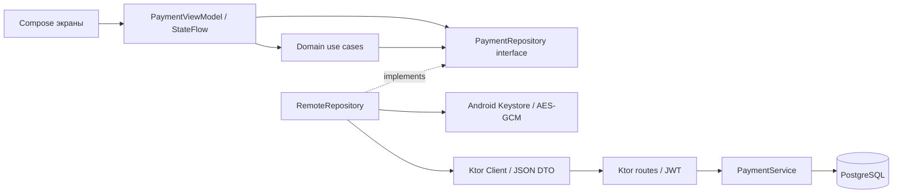
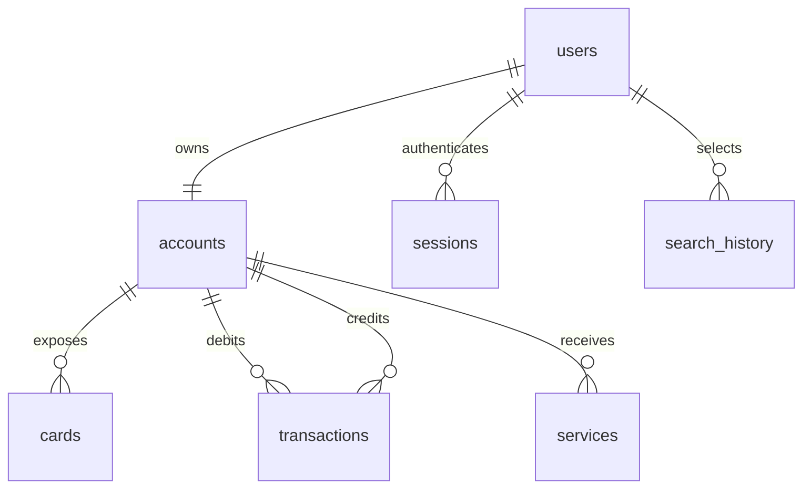

# Архитектура и модель данных

Domain содержит независимые от Android модели и правила. Contracts содержит сериализуемые сетевые DTO; преобразование в domain происходит в Data. Hilt создаёт Ktor Client, RemoteRepository и use cases. Presentation получает только интерфейс и use cases. SavedStateHandle хранит UI-состояние, сервер — данные аккаунта, настройки и историю выбранных объектов.

`users`: нормализованный уникальный email, уникальный телефон, хэш пароля, имя, тема. `accounts`: один RUB-кошелёк на пользователя, неотрицательный BIGINT balance. `cards`: виртуальная ссылка на кошелёк, alias и случайные четыре цифры для отображения. `transactions`: отправитель, получатель, сумма, тип, комментарий, время, уникальный ключ запроса на счёт и SHA-256 тела. `search_history`: составной первичный ключ user_id/item_id, время последнего выбора. `sessions`: UUID токена и срок действия для серверного отзыва.

Операция: проверка → advisory lock для idempotency → поиск существующей операции → разрешение получателя → блокировка обоих счетов по UUID → проверка остатка/переполнения → списание → зачисление → INSERT операции → COMMIT. Исключение на любом шаге вызывает ROLLBACK. Глобальный порядок блокировок исключает циклическое ожидание при встречных переводах. Уникальный индекс служит дополнительной гарантией отсутствия двойной записи.

История: блокировка строки пользователя → UPSERT выбранного ID с clock_timestamp() → удаление всего, кроме 10 последних → чтение актуальных объектов → COMMIT. Очистка использует ту же блокировку, поэтому конкурентная очистка и добавление имеют последовательный результат.

Pagination истории операций использует offset, а порядок — created_at DESC/id DESC. Новые операции между страницами могут смещать offset; клиент удаляет повторяющиеся ID. Для больших объёмов/строгих экспортов следует перейти на cursor pagination и фиксированный snapshot.
